<!-- Images are generated by tools/profile (python3 tools/profile/fetch.py && python3 tools/profile/render.py). Edit that, not the SVGs. -->

Browse all 200+ projects at <a href="https://galtzo.com">galtzo.com</a> ·
<a href="https://github.com/sponsors/pboling">Sponsor</a> ·
<a href="https://discord.gg/3qme4XHNKN">Discord</a> ·
<a href="./docs/README.legacy.md">previous profile</a>

Data from <a href="https://github.com/galtzo-floss/galtzo.com">galtzo.com</a> project YAML. Console and city idea by <a href="https://github.com/georgekobaidze/georgekobaidze">Giorgi Kobaidze</a> (MIT). Palette from sm-urb-design.

