<!-- Generated by tools/profile/render.py (see tools/profile/). Edit that, not this file or the SVGs. -->

<picture><source media="(max-width: 600px)" srcset="./assets/profile/phone/header.svg"></picture>
<picture><source media="(max-width: 600px)" srcset="./assets/profile/phone/banner/banner.svg"></picture>
<a href="https://github.com/sponsors/pboling"><picture><source media="(max-width: 600px)" srcset="./assets/profile/phone/banner/link-1.svg"></picture></a><a href="https://opencollective.com/galtzo-floss"><picture><source media="(max-width: 600px)" srcset="./assets/profile/phone/banner/link-2.svg"></picture></a><a href="https://docs.google.com/document/d/1H9fYtkMFmnkQO1sucrFPt5E3dvhozgVtI31LgpNLmJ4/pub"><picture><source media="(max-width: 600px)" srcset="./assets/profile/phone/banner/link-3.svg"></picture></a><a href="https://discord.gg/3qme4XHNKN"><picture><source media="(max-width: 600px)" srcset="./assets/profile/phone/banner/link-4.svg"></picture></a>
<picture><source media="(max-width: 600px)" srcset="./assets/profile/phone/stats.svg"></picture>
<picture><source media="(max-width: 600px)" srcset="./assets/profile/phone/city.svg"></picture>
<picture><source media="(max-width: 600px)" srcset="./assets/profile/phone/trending/head.svg"></picture>
<a href="https://github.com/resque/resque"><picture><source media="(max-width: 600px)" srcset="./assets/profile/phone/trending/01.svg"></picture></a><a href="https://github.com/ruby-oauth/oauth2"><picture><source media="(max-width: 600px)" srcset="./assets/profile/phone/trending/02.svg"></picture></a><a href="https://github.com/contriboss/ore-light"><picture><source media="(max-width: 600px)" srcset="./assets/profile/phone/trending/03.svg"></picture></a>
<a href="https://github.com/structuredmerge/structuredmerge-ruby"><picture><source media="(max-width: 600px)" srcset="./assets/profile/phone/trending/04.svg"></picture></a><a href="https://github.com/dynamoid/dynamoid"><picture><source media="(max-width: 600px)" srcset="./assets/profile/phone/trending/05.svg"></picture></a><a href="https://github.com/appraisal-rb/setup-ruby-flash"><picture><source media="(max-width: 600px)" srcset="./assets/profile/phone/trending/06.svg"></picture></a>
<picture><source media="(max-width: 600px)" srcset="./assets/profile/phone/trending/foot.svg"></picture>
<picture><source media="(max-width: 600px)" srcset="./assets/profile/phone/history/chart.svg"></picture>
<picture><source media="(max-width: 600px)" srcset="./assets/profile/phone/projects/head.svg"></picture>
<a href="https://github.com/rdp/os"><picture><source media="(max-width: 600px)" srcset="./assets/profile/phone/projects/01.svg"></picture></a><a href="https://github.com/ruby-oauth/oauth2"><picture><source media="(max-width: 600px)" srcset="./assets/profile/phone/projects/02.svg"></picture></a>
<a href="https://github.com/ruby-oauth/oauth"><picture><source media="(max-width: 600px)" srcset="./assets/profile/phone/projects/03.svg"></picture></a><a href="https://github.com/ruby-oauth/version_gem"><picture><source media="(max-width: 600px)" srcset="./assets/profile/phone/projects/04.svg"></picture></a>
<a href="https://github.com/ruby-oauth/snaky_hash"><picture><source media="(max-width: 600px)" srcset="./assets/profile/phone/projects/05.svg"></picture></a><a href="https://github.com/xberg-io/tree-sitter-language-pack"><picture><source media="(max-width: 600px)" srcset="./assets/profile/phone/projects/06.svg"></picture></a>
<a href="https://github.com/resque/resque"><picture><source media="(max-width: 600px)" srcset="./assets/profile/phone/projects/07.svg"></picture></a><a href="https://github.com/ruby-oauth/oauth-tty"><picture><source media="(max-width: 600px)" srcset="./assets/profile/phone/projects/08.svg"></picture></a>
<a href="https://github.com/ruby-oauth/auth-sanitizer"><picture><source media="(max-width: 600px)" srcset="./assets/profile/phone/projects/09.svg"></picture></a><a href="https://github.com/ruby-openid/ruby-openid"><picture><source media="(max-width: 600px)" srcset="./assets/profile/phone/projects/10.svg"></picture></a>
<a href="https://github.com/Dynamoid/dynamoid"><picture><source media="(max-width: 600px)" srcset="./assets/profile/phone/projects/11.svg"></picture></a><a href="https://github.com/ruby-oauth/anonymous_loader"><picture><source media="(max-width: 600px)" srcset="./assets/profile/phone/projects/12.svg"></picture></a>
<a href="https://github.com/ruby-openid/rack-openid"><picture><source media="(max-width: 600px)" srcset="./assets/profile/phone/projects/13.svg"></picture></a><a href="https://github.com/galtzo-floss/flag_shih_tzu"><picture><source media="(max-width: 600px)" srcset="./assets/profile/phone/projects/14.svg"></picture></a>
<a href="https://github.com/ruby-openid/omniauth-openid"><picture><source media="(max-width: 600px)" srcset="./assets/profile/phone/projects/15.svg"></picture></a><a href="https://github.com/galtzo-floss/gem_bench"><picture><source media="(max-width: 600px)" srcset="./assets/profile/phone/projects/16.svg"></picture></a>
<a href="https://github.com/galtzo-floss/sanitize_email"><picture><source media="(max-width: 600px)" srcset="./assets/profile/phone/projects/17.svg"></picture></a><a href="https://github.com/omniauth/omniauth-identity"><picture><source media="(max-width: 600px)" srcset="./assets/profile/phone/projects/18.svg"></picture></a>
<a href="https://github.com/galtzo-floss/seed_migration"><picture><source media="(max-width: 600px)" srcset="./assets/profile/phone/projects/19.svg"></picture></a><a href="https://github.com/rubocop-lts/rubocop-lts"><picture><source media="(max-width: 600px)" srcset="./assets/profile/phone/projects/20.svg"></picture></a>
<a href="https://github.com/omniauth/omniauth-ldap"><picture><source media="(max-width: 600px)" srcset="./assets/profile/phone/projects/21.svg"></picture></a><a href="https://github.com/galtzo-floss/rspec-block_is_expected"><picture><source media="(max-width: 600px)" srcset="./assets/profile/phone/projects/22.svg"></picture></a>
<a href="https://github.com/galtzo-floss/rspec-stubbed_env"><picture><source media="(max-width: 600px)" srcset="./assets/profile/phone/projects/23.svg"></picture></a><a href="https://github.com/structuredmerge/structuredmerge-ruby"><picture><source media="(max-width: 600px)" srcset="./assets/profile/phone/projects/24.svg"></picture></a>
<picture><source media="(max-width: 600px)" srcset="./assets/profile/phone/projects/foot.svg"></picture>
<picture><source media="(max-width: 600px)" srcset="./assets/profile/phone/new/head.svg"></picture>
<a href="https://github.com/galtzo-floss/turbo_tests2"><picture><source media="(max-width: 600px)" srcset="./assets/profile/phone/new/01.svg"></picture></a><a href="https://github.com/kettle-dev/kettle-family"><picture><source media="(max-width: 600px)" srcset="./assets/profile/phone/new/02.svg"></picture></a>
<a href="https://github.com/kettle-dev/kettle-rb"><picture><source media="(max-width: 600px)" srcset="./assets/profile/phone/new/03.svg"></picture></a><a href="https://github.com/kettle-dev/kettle-gha-pins"><picture><source media="(max-width: 600px)" srcset="./assets/profile/phone/new/04.svg"></picture></a>
<a href="https://github.com/kettle-dev/kettle-ndjson"><picture><source media="(max-width: 600px)" srcset="./assets/profile/phone/new/05.svg"></picture></a><a href="https://github.com/kettle-dev/token-resolver"><picture><source media="(max-width: 600px)" srcset="./assets/profile/phone/new/06.svg"></picture></a>
<a href="https://github.com/appraisal-rb/appraisal2-rubocop"><picture><source media="(max-width: 600px)" srcset="./assets/profile/phone/new/07.svg"></picture></a><a href="https://github.com/kettle-dev/nomono"><picture><source media="(max-width: 600px)" srcset="./assets/profile/phone/new/08.svg"></picture></a>
<a href="https://github.com/kettle-dev/kettle-wash"><picture><source media="(max-width: 600px)" srcset="./assets/profile/phone/new/09.svg"></picture></a><a href="https://github.com/kettle-dev/kettle-changelog"><picture><source media="(max-width: 600px)" srcset="./assets/profile/phone/new/10.svg"></picture></a>
<picture><source media="(max-width: 600px)" srcset="./assets/profile/phone/new/foot.svg"></picture>
<picture><source media="(max-width: 600px)" srcset="./assets/profile/phone/feed/head.svg"></picture>
<a href="https://rubygems.org/gems/turbo_tests2/versions/4.0.1"><picture><source media="(max-width: 600px)" srcset="./assets/profile/phone/feed/release-01.svg"></picture></a><a href="https://dev.to/galtzo/gh-profile-cyber-punk-city-spin-2i89"><picture><source media="(max-width: 600px)" srcset="./assets/profile/phone/feed/post-01.svg"></picture></a>
<a href="https://rubygems.org/gems/kettle-family/versions/1.3.41"><picture><source media="(max-width: 600px)" srcset="./assets/profile/phone/feed/release-02.svg"></picture></a><a href="https://dev.to/galtzo/why-flagshihtzu-is-changing-its-default-sql-for-bit-flags-41l9"><picture><source media="(max-width: 600px)" srcset="./assets/profile/phone/feed/post-02.svg"></picture></a>
<a href="https://rubygems.org/gems/rspec-stubbed_env/versions/1.0.18"><picture><source media="(max-width: 600px)" srcset="./assets/profile/phone/feed/release-03.svg"></picture></a><a href="https://dev.to/galtzo/yard-yaml-011-safer-utf-8-handling-for-yaml-documentation-43jh"><picture><source media="(max-width: 600px)" srcset="./assets/profile/phone/feed/post-03.svg"></picture></a>
<a href="https://rubygems.org/gems/yard-timekeeper/versions/0.2.10"><picture><source media="(max-width: 600px)" srcset="./assets/profile/phone/feed/release-04.svg"></picture></a><a href="https://dev.to/galtzo/yard-fence-090-cleaner-yard-docs-when-markdown-braces-get-in-the-way-2683"><picture><source media="(max-width: 600px)" srcset="./assets/profile/phone/feed/post-04.svg"></picture></a>
<a href="https://rubygems.org/gems/yard-fence/versions/0.9.11"><picture><source media="(max-width: 600px)" srcset="./assets/profile/phone/feed/release-05.svg"></picture></a><a href="https://dev.to/galtzo/yard-timekeeper-stop-yard-timestamp-churn-in-checked-in-docs-369o"><picture><source media="(max-width: 600px)" srcset="./assets/profile/phone/feed/post-05.svg"></picture></a>
<a href="https://rubygems.org/gems/debug_logging/versions/4.1.6"><picture><source media="(max-width: 600px)" srcset="./assets/profile/phone/feed/release-06.svg"></picture></a><a href="https://dev.to/galtzo/rel-oauth2-v2018-43pf"><picture><source media="(max-width: 600px)" srcset="./assets/profile/phone/feed/post-06.svg"></picture></a>
<a href="https://rubygems.org/gems/flag_shih_tzu/versions/1.0.7"><picture><source media="(max-width: 600px)" srcset="./assets/profile/phone/feed/release-07.svg"></picture></a><a href="https://dev.to/galtzo/ann-appraisal2-v306-support-frozen-appraisal-lockfiles-20ml"><picture><source media="(max-width: 600px)" srcset="./assets/profile/phone/feed/post-07.svg"></picture></a>
<picture><source media="(max-width: 600px)" srcset="./assets/profile/phone/feed/foot.svg"></picture>
<picture><source media="(max-width: 600px)" srcset="./assets/profile/phone/contributors/head.svg"></picture>
<a href="https://github.com/ruby/rubygems"><picture><source media="(max-width: 600px)" srcset="./assets/profile/phone/contributors/01.svg"></picture></a><a href="https://github.com/ruby/rexml"><picture><source media="(max-width: 600px)" srcset="./assets/profile/phone/contributors/02.svg"></picture></a><a href="https://github.com/rails/rails"><picture><source media="(max-width: 600px)" srcset="./assets/profile/phone/contributors/03.svg"></picture></a>
<a href="https://github.com/hashie/hashie"><picture><source media="(max-width: 600px)" srcset="./assets/profile/phone/contributors/04.svg"></picture></a><a href="https://github.com/mongodb/bson-ruby"><picture><source media="(max-width: 600px)" srcset="./assets/profile/phone/contributors/05.svg"></picture></a><a href="https://github.com/oxidize-rb/rb-sys"><picture><source media="(max-width: 600px)" srcset="./assets/profile/phone/contributors/06.svg"></picture></a>
<a href="https://github.com/matsadler/magnus"><picture><source media="(max-width: 600px)" srcset="./assets/profile/phone/contributors/07.svg"></picture></a><a href="https://github.com/spinel-coop/rv/"><picture><source media="(max-width: 600px)" srcset="./assets/profile/phone/contributors/08.svg"></picture></a><a href="https://www.github.com/Faveod/ruby-tree-sitter"><picture><source media="(max-width: 600px)" srcset="./assets/profile/phone/contributors/09.svg"></picture></a>
<a href="https://github.com/apache/skywalking-eyes"><picture><source media="(max-width: 600px)" srcset="./assets/profile/phone/contributors/10.svg"></picture></a><a href="https://github.com/joker1007/tree_stump"><picture><source media="(max-width: 600px)" srcset="./assets/profile/phone/contributors/11.svg"></picture></a><picture><source media="(max-width: 600px)" srcset="./assets/profile/phone/contributors/blank-3.svg"></picture>
<picture><source media="(max-width: 600px)" srcset="./assets/profile/phone/contributors/foot.svg"></picture>

<picture><source media="(max-width: 600px)" srcset="./assets/profile/phone/footer.svg"></picture>

Browse all 200+ projects at <a href="https://galtzo.com">galtzo.com</a> ·
<a href="https://github.com/sponsors/pboling">Sponsor</a> ·
<a href="https://discord.gg/3qme4XHNKN">Discord</a> ·
<a href="./docs/README.legacy.md">previous profile</a>

Updated automatically by my pet robot <a href="https://github.com/autobolt">@autobolt</a>. Data from <a href="https://github.com/galtzo-floss/galtzo.com">galtzo.com</a> project YAML. Console and city idea by <a href="https://github.com/georgekobaidze/georgekobaidze">Giorgi Kobaidze</a> (MIT). Inspired by <a href="https://github.com/jdx/jdx">Jeff Dickey's profile</a> (trending strip, day/night sky, plane, legend); ideas only, no code taken. Palette from <a href="https://github.com/9thBit-llc/sm-urb-design">sm-urb-design</a>.

